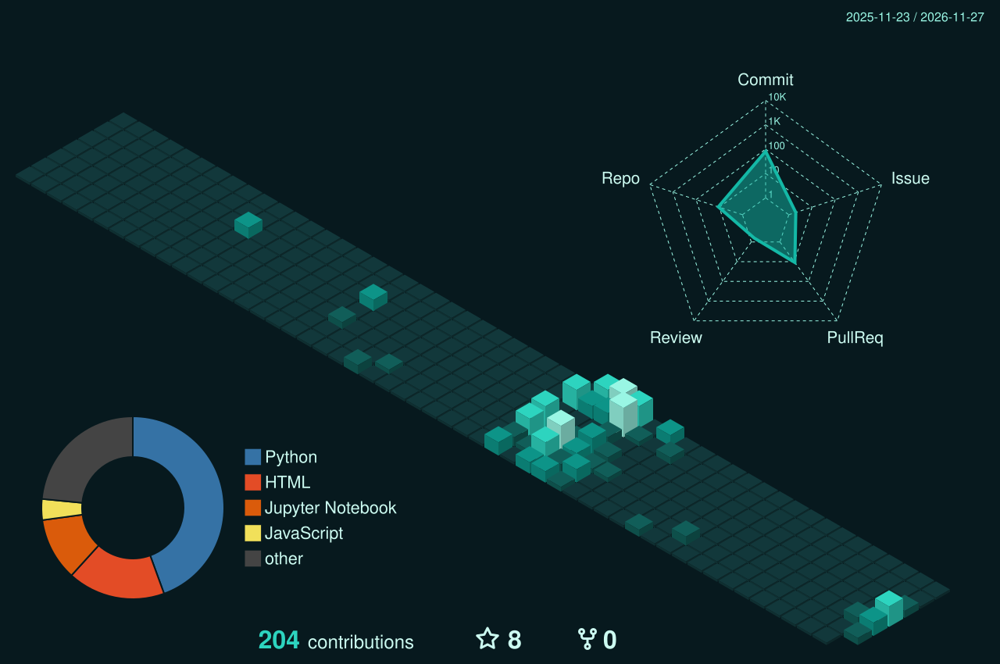

<!-- Animated profile header -->

  

  

  
  
  

## About Me

I'm a final-year **BSc (Hons) Computer Science with Artificial Intelligence** student at **Birmingham City University**, on track for First Class Honours and expecting to graduate in 2027.

I enjoy building intelligent, practical software — from machine learning models and data pipelines to full-stack applications and AI-powered systems.

- **Visiting Demonstrator** at Birmingham City University, supporting students with object-oriented programming.
- **Winner** of the 2026 Mondelēz STEAM FutureBite hackathon as part of a student team.
- Currently developing **UniIQ**, a retrieval-augmented generation (RAG) university assistant for my final-year project.
- Exploring deep learning, LLM applications, MLOps and scalable backend development.
- Open to **2027 graduate opportunities** in AI, machine learning and software engineering.

## Featured Projects

| Project | Description | Technologies |
| :--- | :--- | :--- |
| **[VeloCast](https://github.com/Thenul14/velocast-bike-demand)** | Interactive bike rental demand prediction application using a pre-trained Random Forest model. | React, Python, scikit-learn, Vercel |
| **[Bike Sharing MLOps Pipeline](https://github.com/Thenul14/bike-sharing-mlops-pipeline)** | End-to-end data engineering and ML pipeline for bike rental demand prediction. | Airflow, MLflow, Docker, MariaDB, Redis, FastAPI |
| **[FutureBite](https://github.com/Thenul14/future-bite)** | Hackathon-winning career discovery platform connecting talent with the food manufacturing industry. | HTML, CSS, JavaScript |
| **[Football Player Market Value Prediction](https://github.com/Thenul14/football-player-market-value-prediction)** | Machine learning project with feature analysis, model validation and an interactive prediction app. | Python, XGBoost, Streamlit |

## Currently Building

| Project | Focus | Status |
| :--- | :--- | :--- |
| **UniIQ** | RAG-based university assistant with document retrieval and source-grounded answers. | In development |
| **Plant Disease Classification** | Comparing deep learning performance and robustness across RGB, grayscale and segmented images. | In development |

## Technical Skills

**Languages**

**Artificial Intelligence & Machine Learning**

`Deep Learning` · `RAG` · `XGBoost` · `Pandas` · `NumPy` · `Keras`

**Full-Stack Development & Databases**

**MLOps & Development Tools**

`Apache Airflow` · `MLflow` · `MariaDB` · `REST APIs`

## GitHub Activity

  
  

### Contribution Skyline

  

  <a href="https://github.com/Thenul14">View my GitHub contributions and repositories</a>

---

<strong>Building intelligent solutions. Learning continuously. Turning ideas into impact.</strong>

  

